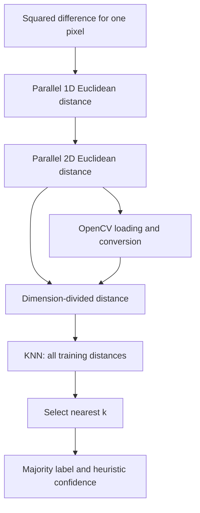

# Parallel Image Distance and KNN Classification

[](https://isocpp.org/)

This C++20 project implements five image-distance variants and uses the fifth in a multithreaded brute-force K-nearest-neighbor classifier for CIFAR-10. It also includes thread-pool, barrier, and reduction utilities.

## Architecture

The distance code builds from one pixel pair to arrays and loaded images. The KNN demo compares one test image with the training set.



## Features

- Five image-distance algorithms, from a scalar pixel operation to threaded image comparisons.
- Manual work partitioning with `std::thread`, atomic reductions, and an atomic work index.
- OpenCV image loading, color conversion, resizing, and batch comparison.
- A brute-force KNN classifier for CIFAR-10's binary batch format.
- Six CTest executables for the five algorithms and the classifier.
- Optional MPI code paths that are disabled in the default CMake configuration.

## Results

The previously recorded Algorithm 2 benchmark used a synthetic one-million-element array and the best of five runs per thread count. The record identifies an 8-core system and an MSVC Release build.

| Threads | Time (ms) | Speedup | Efficiency |
|---:|---:|---:|---:|
| 1 | 2.85 | 1.00x | 100% |
| 2 | 1.52 | 1.88x | 94% |
| 4 | 0.82 | 3.48x | 87% |
| 8 | 0.53 | 5.38x | 67% |
| 16 | 0.49 | 5.82x | 36% |

These figures describe the 1D distance workload. They do not measure end-to-end KNN speed or classifier accuracy. The KNN demo classifies the first 150 test images, reports their accuracy, and reports classification runtime.

Algorithm 5 computes root-mean-square error over every stored channel value, then divides by the 8-bit maximum value (255) and scales to 0 to 100. The array, image, and detailed overloads use the same rule. The classifier's separate confidence score is a formula-based heuristic, not a calibrated probability.

## Quick Start

### Prerequisites

- C++20 compiler, CMake 3.16 or newer, and OpenCV 4.x.
- The CIFAR-10 binary batches are included under `data/cifar-10-batches-bin/` and run the classifier demo.
- Python 3 and Matplotlib only to generate plots.

### Configure and build

```powershell
cmake -B build -DCMAKE_BUILD_TYPE=Release
cmake --build build --config Release
```

If CMake cannot find OpenCV, pass its package directory:

```powershell
cmake -B build -DCMAKE_BUILD_TYPE=Release -DOpenCV_DIR="C:/path/to/opencv/build"
```

### Run the demos

```powershell
.\build\Release\main.exe
.\build\Release\knn_demo.exe data/cifar-10-batches-bin
```

The repository includes the five training batches and `test_batch.bin` under `data/cifar-10-batches-bin/`; use that directory when running `knn_demo`.

## Technical Design

### Distance algorithms

Algorithm 1 squares the difference for one pair of values. Algorithm 2 partitions a flat array into chunks, accumulates squared differences, joins its worker threads, and returns the square root of the total. Algorithm 3 applies the same Euclidean calculation to image rows; it also includes a nested-threading variant. Algorithm 4 converts OpenCV images into the project's pixel-array representation. Algorithm 5 divides the 2D Euclidean distance by the number of stored row values and multiplies by 100; this scaling does not remove resolution dependence.

### KNN classifier

The CIFAR-10 loader reads five 10,000-image training batches and one 10,000-image test batch. A worker index distributes training images across threads. The classifier computes a distance to each training image, selects the nearest `k` candidates with `nth_element` and a partial sort, and predicts the most common label. The standalone demo classifies the first 150 test images and prints accuracy and elapsed classification time for that subset.

### Concurrency and optional utilities

The distance algorithms create and join threads directly. A reusable thread pool, barrier, and reduction helpers are provided, but the main algorithm chain does not use the barrier or thread pool. MPI branches are guarded by `USE_MPI`; `find_package(MPI)` is commented out, so the default build does not compile or test those branches.

## Project Structure

- `include/`: algorithm interfaces, data types, and parallel utility declarations.
- `src/`: algorithm implementations, OpenCV integration, classifier, and demos.
- `tests/`: six test executables registered with CTest.
- `benchmarks/`: plot script and benchmark output location.
- `data/cifar-10-batches-bin/`: CIFAR-10 binary batches used by the demo and dataset-backed classifier test.

## Tests

Configure and build the project, then run its six registered CTest executables. The KNN test loads the included CIFAR-10 data and classifies one held-out image:

```powershell
ctest --test-dir build -C Release --output-on-failure
```

Running tests requires CMake, a C++20 compiler, and OpenCV. When OpenCV is installed, tests can be configured and run using CTest as shown above.

## License

MIT License

Copyright (c) [2026] [Schrodi-Ø-Ao]

Permission is hereby granted, free of charge, to any person obtaining a copy
of this software and associated documentation files (the "Software"), to deal
in the Software without restriction, including without limitation the rights
to use, copy, modify, merge, publish, distribute, sublicense, and/or sell
copies of the Software, and to permit persons to whom the Software is
furnished to do so, subject to the following conditions:

The above copyright notice and this permission notice shall be included in all
copies or substantial portions of the Software.

THE SOFTWARE IS PROVIDED "AS IS", WITHOUT WARRANTY OF ANY KIND, EXPRESS OR
IMPLIED, INCLUDING BUT NOT LIMITED TO THE WARRANTIES OF MERCHANTABILITY,
FITNESS FOR A PARTICULAR PURPOSE AND NONINFRINGEMENT. IN NO EVENT SHALL THE
AUTHORS OR COPYRIGHT HOLDERS BE LIABLE FOR ANY CLAIM, DAMAGES OR OTHER
LIABILITY, WHETHER IN AN ACTION OF CONTRACT, TORT OR OTHERWISE, ARISING FROM,
OUT OF OR IN CONNECTION WITH THE SOFTWARE OR THE USE OR OTHER DEALINGS IN THE
SOFTWARE.